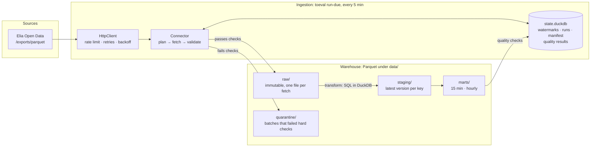

# toeval

*Toeval* is Dutch for "coincidence".

A personal data platform that continuously ingests Belgian open data into a local DuckDB + Parquet warehouse. It is built to run like a small production system: scheduled incremental loads, an immutable raw layer, rebuildable SQL models, quality checks, and tests that never touch the network.

Two projects will sit on top of it:

1. **A spurious correlation tracker** that hunts for absurd correlations across datasets, then tracks week by week how they fall apart on new data. Playful tone, rigorous statistics.
2. **JEPA on unlabeled time series:** self-supervised pretraining on the warehouse, benchmarked honestly against simple baselines trained on the same few labels.

**Status:** Phase 1 (foundation + Elia grid data) is complete. The pipeline ingests Belgian electricity load, wind and solar generation every day, back to 2015. Phase 2 has started: an Open-Meteo weather connector (ERA5, 7 points around Belgium) is loaded back to 2015 and ingests daily, joined to the energy data in one hourly table. An IRCEL-CELINE air quality connector (NO2, PM10, PM2.5, O3 at 15 stations) is built; its staging and history download follow.

## What's in the warehouse

[Elia](https://opendata.elia.be), the Belgian transmission system operator, publishes grid data per quarter-hour:

| Stream | Dataset | Since | Rows | Content |
|---|---|---|---|---|
| `elia/load` | ods001 | 2015-01-01 | 414 k | total load, plus most-recent, day-ahead and week-ahead forecasts |
| `elia/wind` | ods031 | 2015-01-01 | 2.1 M | wind generation in 5 parts (offshore; onshore Flanders/Wallonia × Elia/DSO grid) |
| `elia/solar` | ods032 | 2020-10-01 | 3.0 M | solar generation for Belgium, 3 regions and 10 provinces |

(Rows as of the first load on 2026-10-18.) They come out as two marts:

- `mart_energy_15min`: national load, solar and wind (measured and day-ahead forecast) per quarter-hour on a gap-free grid.
- `mart_energy_hourly`: the same per hour, NULL unless all four quarter-hours are present.
- `mart_weather_hourly`: weather per location and hour, aligned to the same hour intervals (see below).
- `mart_energy_weather_hourly`: one row per hour with the energy columns, the mean weather over the 6 land points, and offshore wind.

For 2025 the mart gives a Belgian load of 80.2 TWh, solar 10.2 TWh and wind 12.0 TWh.

[Open-Meteo](https://open-meteo.com) serves hourly ERA5 reanalysis weather. `openmeteo/hourly` covers 7 points: Antwerp, Brussels, Ghent, Liège, Ostend, Libramont (Ardennes) and the Belgian offshore wind zone. It has 9 variables (temperature, humidity, precipitation, cloud cover, pressure, wind at 10 m and 100 m, wind direction, solar radiation). ERA5 runs ~5–6 days behind real time ([ADR 0008](docs/decisions/0008-open-meteo-weather.md)). ERA5 values don't all mean the same thing at their timestamp: rain and solar radiation cover the hour before it, the rest are snapshots. `mart_weather_hourly` turns both into hour intervals like Elia's (preceding-hour values move back an hour, snapshots are averaged over the hour's two ends, wind direction comes from the mean wind vector). Against Elia's offshore wind output over 2015–2026, the same hour correlates best in every year, and at 15-minute resolution the match is centred on zero.

[IRCEL-CELINE](https://www.irceline.be) publishes hourly air quality from the regional measuring networks. `irceline/hourly` covers NO2, PM10, PM2.5 and O3 at 15 stations chosen for long history (most since 2011–2012) and closeness to the weather points, five of them in Antwerp: 54 series in all. Values arrive within a few hours; their timestamp is the *end* of the hour, so the marts will shift them back an hour ([ADR 0009](docs/decisions/0009-irceline-air-quality.md)). The connector is built; the stream stays paused until staging exists.

## Architecture



### Ingestion

Each source is a **connector** that implements three methods: `plan` (what to request this run), `fetch` (one request → an Arrow table) and `next_watermark` (how a batch moves the stream's progress marker). Everything else lives in a shared base class:

- **HTTP:** a token-bucket rate limit, retries on connection errors, 429 and 5xx with capped exponential backoff and jitter, `Retry-After` support (capped, so a server can't stall a run for hours), auth from environment variables, and conditional GET (`ETag` / `If-Modified-Since`).
- **Quality gate before raw:** key columns present and non-null, no duplicate keys, plus source-specific checks. For Elia, Belgian solar must equal the sum of its three regions (it matched to 1e-12 MW over all of 2025). A batch that fails goes to `quarantine/`, never into raw, and the run fails.
- **All-or-nothing state:** the watermark, schedule state and HTTP validators are committed in one transaction, and only if every request in the run succeeded. Every run is recorded as success or failed, even after Ctrl+C.

The interface was designed against three source shapes, and the test suite has a fake for each: queryable history with revisions (Elia), live-only polling with ETags (iRail, Phase 2), and monthly files keyed by reference period (Statbel, Phase 2).

### Incremental loads and revisions

Elia corrects data after publishing it and doesn't document how far back. Each incremental run therefore fetches from `watermark − 14 days` to `now + forecast horizon`, and once a month it re-fetches 90 days. The watermark is the last *measured* quarter-hour, not the last row, because load forecasts run a week ahead. Missed runs (the laptop was off) catch up automatically on the next run.

Raw is append-only: every fetch is kept, and a batch is skipped only when it provably adds nothing. That rule handles the case where a value changes and then changes back (A → B → A), so the latest version is never lost. Keeping every version is also how revisions get measured: the `revision_lag` quality check compares successive raw versions of each quarter-hour, and the window sizes will be tuned from it.

### Transformation

`toeval transform` rebuilds staging and the marts from raw in about 9 seconds (5.4 M raw rows). With a full rebuild at that speed, incremental models would add complexity without saving anything worth having. All transformations are plain `.sql` files that reference only view names, never paths:

- **Staging:** the latest ingested version per natural key, typed columns with units, UTC timestamps.
- **Marts:** keyed on UTC, with Brussels local-time columns for grouping by day (23, 24 or 25 hours). Gaps stay visible as NULL rows; nothing is imputed.
- **The Elia hierarchy is handled deliberately:** national solar is the published `Belgium` row (summing all rows would triple-count), and national wind is the sum of its five parts, NULL unless all five are present.

### Quality checks

After every transform, SQL checks run per source: duplicate keys, grid gaps, recent missing measurements, incomplete wind parts, freshness and revision lag. Freshness and revision-lag limits are set per stream, because ERA5 is days behind by design. They **warn instead of failing**, since the hard checks already ran at ingestion, and their results are logged, stored and shown by `toeval status`.

They found real issues in Elia's history (details in [ADR 0006](docs/decisions/0006-staging-marts-quality.md)):

- The 23:45 solar value is missing on 638 nights between November 2022 and October 2024.
- An hour of load and wind measurements is missing at two daylight-saving changes.

### Scheduling

One Windows Task Scheduler entry runs `toeval run-due` every 5 minutes, and each stream has its own schedule (Elia: daily at 12:00 Brussels time). If a stream fails, it retries after 5 minutes, then 10, 20 and so on, up to 6 hours, so a broken source isn't hammered. A lock file prevents overlapping runs.

### Why DuckDB + Parquet, not Spark or a cloud warehouse

The whole warehouse is a few hundred MB on one laptop. Spark would add a JVM, cluster semantics and seconds of startup to work that DuckDB does in under ten seconds on one machine. A cloud warehouse would add cost, credentials and a network dependency to a personal project. Neither earns its complexity at this scale.

The design keeps a migration cheap anyway:

- Raw is plain Parquet in Hive-style partitions (`ingest_date=YYYY-MM-DD/`), which Spark, BigQuery, Snowflake and Databricks all read directly.
- Every transformation is a `.sql` file that references only view names, so porting it means binding the views to tables and fixing dialect details, not rewriting logic.
- Raw is immutable and everything downstream is derived, so a migration only has to copy raw and re-run the SQL.

The point to revisit is raw volume. Phase 2 adds live sources such as iRail train departures, polled every few minutes, so file counts and sizes will grow. That trade-off is recorded in [ADR 0004](docs/decisions/0004-connector-interface.md).

## Design decisions

Each significant decision has a short record with its context and trade-offs:

| | |
|---|---|
| [0001](docs/decisions/0001-duckdb-parquet-warehouse.md) | DuckDB + Parquet in raw / staging / marts layers |
| [0002](docs/decisions/0002-incremental-loads-revision-window.md) | Incremental loads with a watermark and a measured revision window |
| [0003](docs/decisions/0003-elia-national-aggregation.md) | National Elia totals: use the published total, never sum the hierarchy |
| [0004](docs/decisions/0004-connector-interface.md) | A connector interface that doesn't assume Elia's patterns |
| [0005](docs/decisions/0005-scheduled-operation.md) | Scheduled operation: one task, retry backoff, no console window |
| [0006](docs/decisions/0006-staging-marts-quality.md) | Staging, marts and quality checks: full rebuilds, warnings not failures |
| [0007](docs/decisions/0007-admin-console.md) | A local admin console that never becomes a second writer |
| [0008](docs/decisions/0008-open-meteo-weather.md) | Open-Meteo ERA5 weather at 7 points, and how its hours line up with Elia's |
| [0009](docs/decisions/0009-irceline-air-quality.md) | IRCEL-CELINE air quality at 15 curated stations |

## Running it

Requirements: Windows (the scheduler script uses Task Scheduler; the pipeline itself is plain Python), [uv](https://docs.astral.sh/uv/), and Python 3.12 (uv installs it if needed).

```powershell
git clone https://github.com/AlexanderJVP/toeval.git
cd toeval
uv sync
copy .env.example .env               # optional: data dir, log level, user agent

uv run toeval ingest elia            # first run: full history since 2015, ~27 minutes
uv run toeval ingest openmeteo       # first run: weather since 2015, ~5 minutes (once per hour at most)
uv run toeval status                 # streams, next runs, quality warnings
.\scripts\scheduled-task.ps1         # run-due every 5 minutes from now on
```

Other commands:

```powershell
uv run toeval ingest elia load                                    # one stream, now
uv run toeval backfill elia wind --from 2025-01-01 --to 2026-01-01  # re-fetch a range (Brussels time)
uv run toeval transform                                           # rebuild staging + marts, run checks
.\scripts\scheduled-task.ps1 -Uninstall
```

Exit codes: 0 ok, 1 a stream or the transform failed, 2 usage error, 3 another run holds the lock. Logs go to `data/logs/toeval.log`.

For a visual overview, `uv run python -m toeval ui` opens a local admin console at http://127.0.0.1:8765. It shows overall health, each stream's freshness and runs, the warehouse layers, the quality checks and the scheduled task's state. While a run is in progress, a live diagram and feed show each request, each raw file written and each model rebuilt, from progress events the pipeline writes to `data/state/events.jsonl`. Buttons start a fetch or a rebuild (as the normal `toeval` commands, in the background), pause or resume a stream, and change a stream's schedule or revision window; changes are written to `sources.toml` ([ADR 0007](docs/decisions/0007-admin-console.md)).

To stop the scheduled runs of one stream without touching the others: `uv run toeval pause elia wind` (and `resume`). It is stored in `sources.toml`; explicit `ingest` and `backfill` still run a paused stream.

Reading the marts:

```python
import duckdb

rows = duckdb.sql("""
    SELECT hour_start_local::DATE AS day, round(sum(solar_mw)) AS solar_mwh
    FROM 'data/marts/mart_energy_hourly.parquet'
    WHERE solar_mw IS NOT NULL
    GROUP BY day ORDER BY day DESC LIMIT 7
""").fetchall()
for day, mwh in rows:
    print(day, mwh)
```

Schedules, revision windows and rate limits can be overridden per source and stream in an optional `sources.toml` (gitignored: it's local operating state), without code changes:

```toml
[elia.streams.load]
schedule = { kind = "daily", at = "09:00" }
revision_window = "21d"
```

## Development

```powershell
uv run pytest                  # offline: recorded API responses, fake clocks, no sleeping
uv run pytest -m live          # smoke test against the real Elia API
uv run ruff check . ; uv run ruff format .
uv run pre-commit install      # ruff + hygiene hooks on every commit
```

CI runs lint, format and tests on Windows for every push.

```text
src/toeval/
  cli.py                    typer CLI: ingest, backfill, run-due, transform, status, ui
  pipeline.py               what is due, retry backoff, sources.toml overrides
  state.py                  state DB: watermarks, runs, raw manifest, quality results
  lock.py                   single-writer lock file
  connectors/
    base.py                 Connector: the run loop, quality gate, state commit
    spec.py                 SourceSpec / StreamSpec: schedules, auth, HTTP policy
    http.py                 HttpClient: rate limit, retries, conditional GET
    planning.py             time-window planning for time-series sources
    elia.py                 the Elia connector
    openmeteo.py            the Open-Meteo (ERA5 weather) connector
    irceline.py             the IRCEL-CELINE (air quality) connector
  warehouse/
    raw.py                  immutable raw writer and quarantine
    transform.py            rebuilds staging + marts, runs quality checks
    sql/                    staging/, marts/, quality/ (plain SQL)
  ui/                       admin console: FastAPI app, snapshot, static page
tests/
  fakes.py                  one fake source per shape (history, live, periodic)
  fixtures/elia/            recorded Elia exports
  fixtures/openmeteo/       a recorded Open-Meteo archive response
  fixtures/irceline/        recorded IRCEL-CELINE listings and data
docs/decisions/             architecture decision records
scripts/scheduled-task.ps1  Task Scheduler setup
```

## Roadmap

1. ~~**Foundation + Elia:** connector interface, Elia backfill and incremental loads, raw → staging → marts, quality checks, scheduling, tests.~~
2. **More sources:** Open-Meteo weather (done), IRCEL-CELINE air quality, a shared calendar for daily and weekly grains, Statbel / Antwerp statistics, iRail trains. Telraam traffic counts are set aside for now.
3. **Correlation tracker:** a weekly scan with multiple-testing correction, detrending and out-of-sample tracking. Planned framing: "a naive scan finds X, rigorous methods keep Y, and here is how both decay".
4. **JEPA:** self-supervised pretraining (mask time spans, predict their latent representation), few-label downstream tasks, and an honest comparison against simple baselines. With a corpus this small, "the baselines win" is a legitimate result and will be reported as such.
5. **Presentation:** a public dashboard or report.

## Licence and data attribution

The code is MIT-licensed ([LICENSE](LICENSE)). The data is not covered by that licence: Elia data is © Elia, published under the [Elia Open Data Licence](https://opendata.elia.be). The recorded test fixtures in `tests/fixtures/elia/` are small extracts of it. Weather data: [Open-Meteo](https://open-meteo.com) (CC-BY 4.0), based on Copernicus Climate Change Service ERA5 reanalysis (Hersbach et al., 2023); free use is limited to non-commercial purposes. `tests/fixtures/openmeteo/` holds one recorded response. Air quality data: [IRCEL-CELINE](https://www.irceline.be) (Belgian Interregional Environment Agency), CC BY 4.0; `tests/fixtures/irceline/` holds recorded responses.
